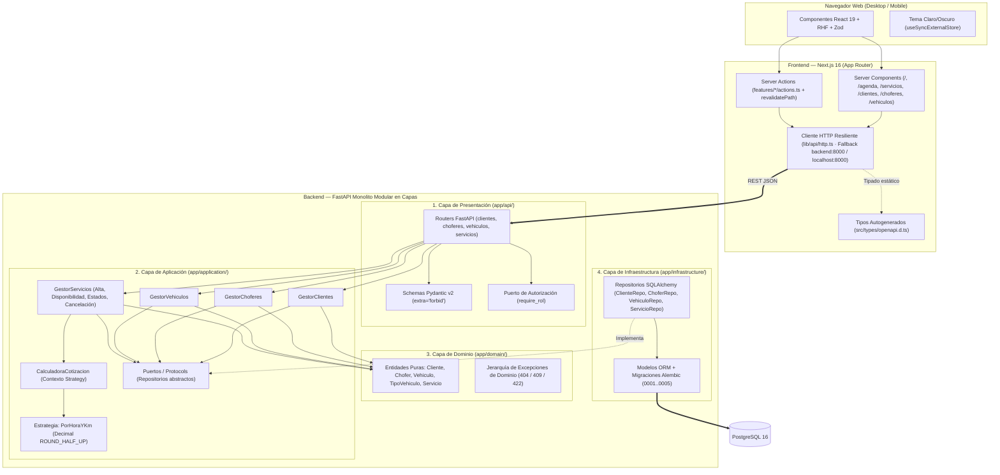
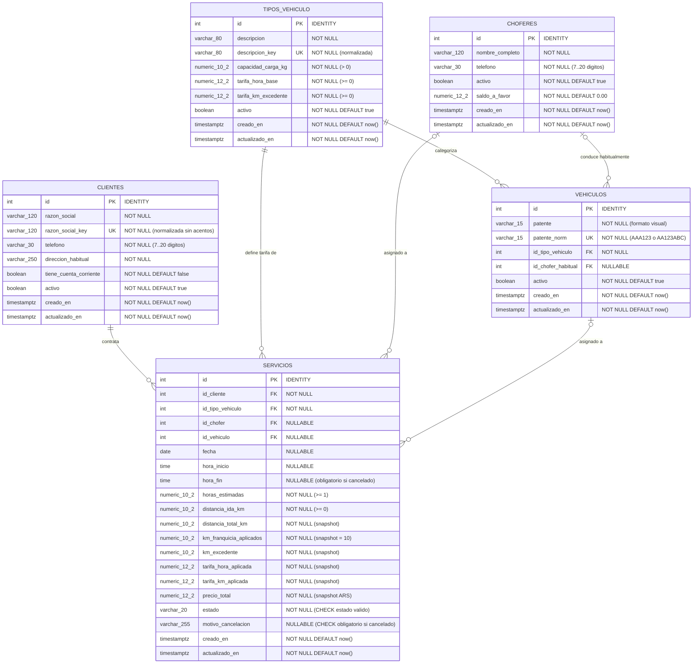
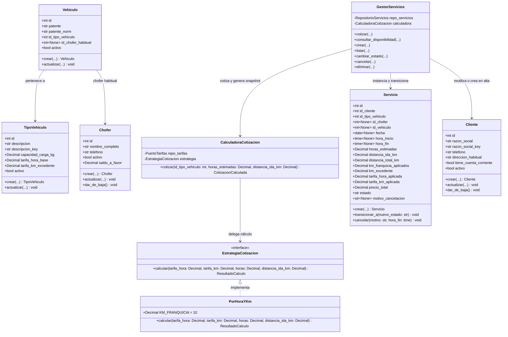
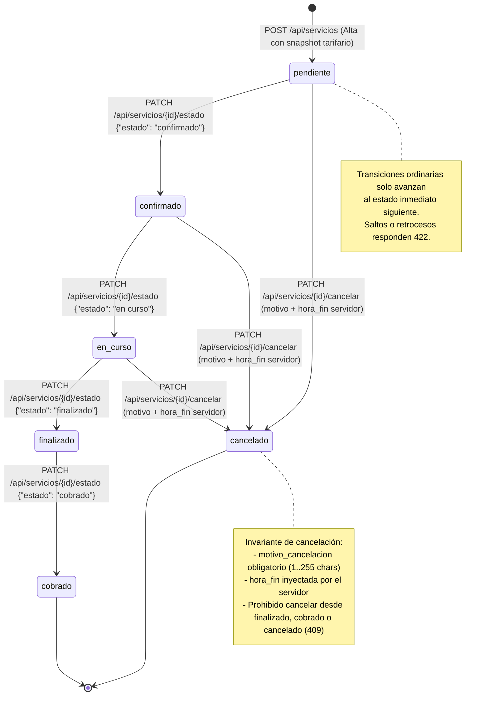
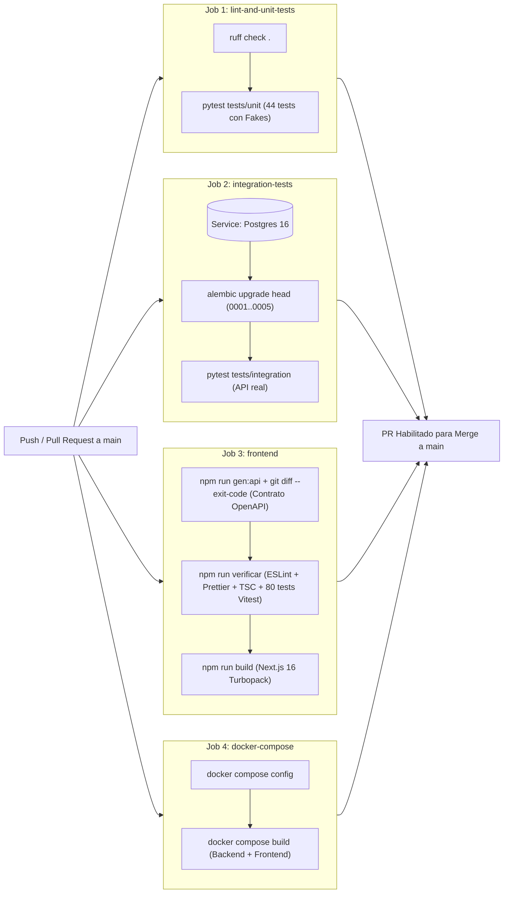

# Diagramas de Arquitectura, Dominio, Base de Datos y Estados

**Proyecto**: Fletes y Mudanzas Express (MVP 1)  
**Cátedra**: Trabajo Integrador de Prácticas Pre-Profesionales 1 (2026) — Licenciatura en Sistemas, UNLa  

Este documento contiene los diagramas estructurales y de comportamiento generados a partir de la arquitectura implementada en el repositorio.

---

## 1. Diagrama de Arquitectura en 4 Capas (Monolito Modular + Next.js 16)

El sistema evita microservicios prematuros y organiza el backend en **4 capas concéntricas** con inversión de dependencias mediante `Protocol` de Python, consumidas por el frontend **Next.js 16 (App Router)** a través de un contrato OpenAPI tipado.

---

## 2. Diagrama Entidad-Relación (ERD) de Base de Datos (Migraciones `0001` a `0005`)

Representa el esquema relacional persistido en PostgreSQL 16 mediante Alembic.

> **Nota**: este ERD refleja las migraciones `0001` a `0005`. El modelo RBAC objetivo del Ticket 1
> (`roles`, `usuarios` y la relación con `choferes`) se especifica en
> [`especificacion-rbac.md`](./especificacion-rbac.md), sección 6.

---

## 3. Diagrama de Clases del Dominio y Patrón Strategy de Cotización

Muestra las entidades de dominio puras (`app/domain/`) junto con el patrón **Strategy** implementado en `app/application/cotizacion/` para aislar los cambios en la fórmula tarifaria del cliente.

---

## 4. Diagrama de Máquina de Estados del Servicio (`Servicio`)

Modela las reglas invariantes de transición en `app/domain/servicio.py` y el constraint `CHECK` de PostgreSQL (migraciones `0004` y `0005`).

---

## 5. Flujo de Integración Continua (GitHub Actions CI) y Docker Compose

Representa los **4 jobs paralelos/secuenciales** configurados en `.github/workflows/ci.yml` para garantizar que el código funcione en cualquier máquina del equipo.

