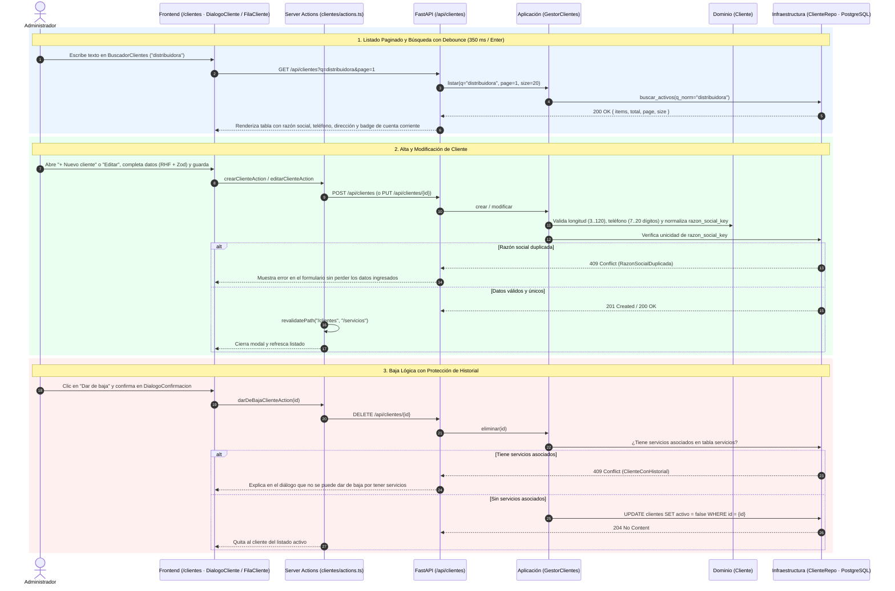
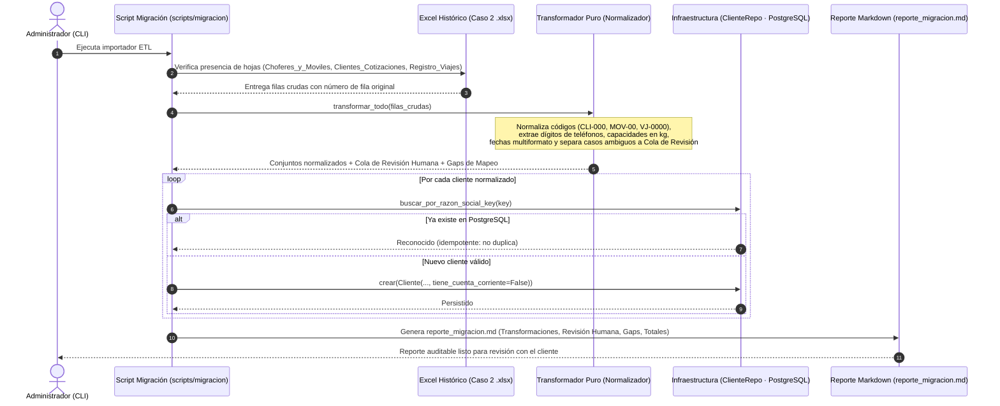
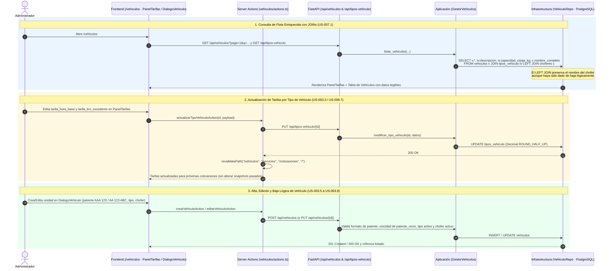
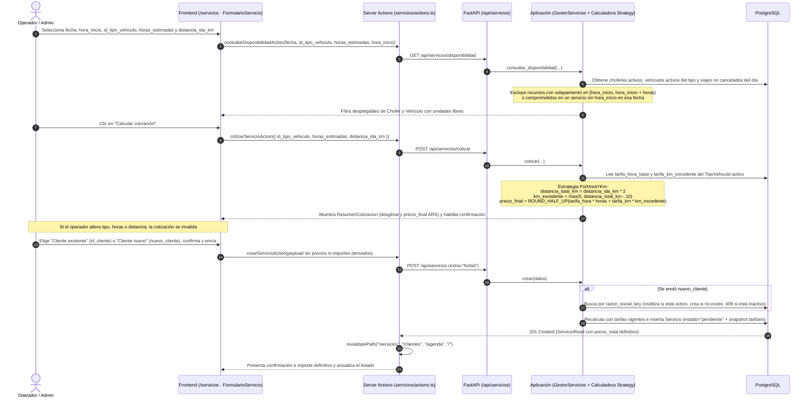
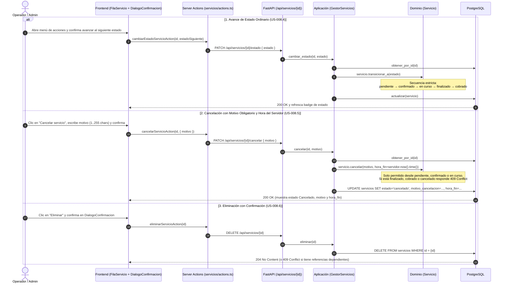
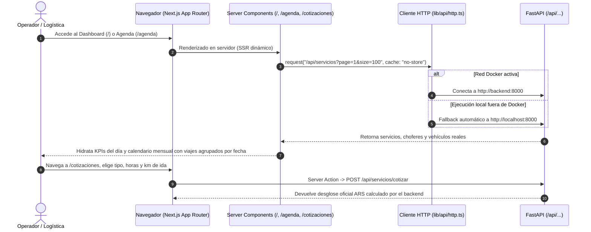
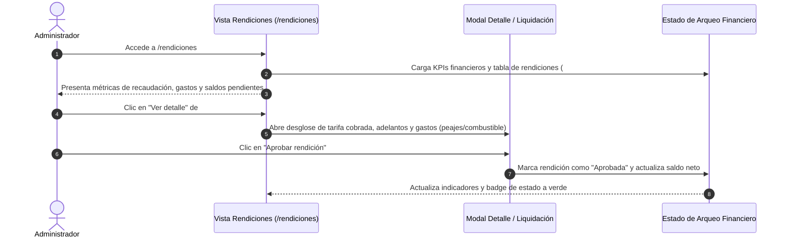
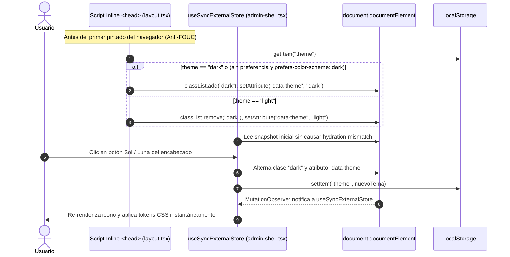
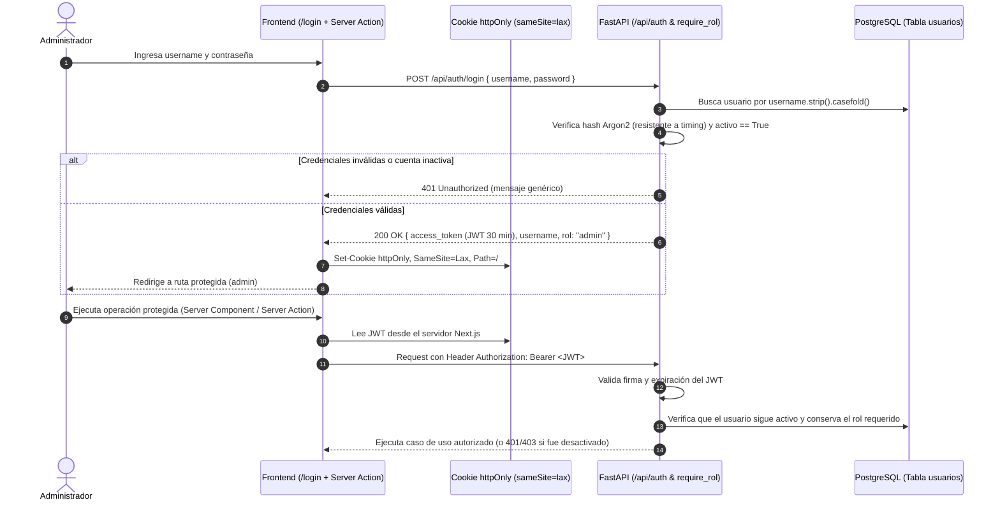

# Catálogo de Diagramas de Secuencia del Sistema (SSD)

**Proyecto**: Fletes y Mudanzas Express (MVP 1)  
**Cátedra**: Trabajo Integrador de Prácticas Pre-Profesionales 1 (2026) — Licenciatura en Sistemas, UNLa  

Este documento reúne los **10 Diagramas de Secuencia del Sistema (SSD)** correspondientes a todas las Historias de Usuario recopiladas en [`historias-de-usuario.md`](./historias-de-usuario.md).

---

## SSD-01: Gestión de Clientes — Alta, Búsqueda Normalizada, Edición y Baja Protegida (`001` + `005` + `008`)

Cubre `US-001.1`, `US-001.2`, `US-001.3`, `US-001.4`, `US-005.2` y `US-008.7`.



---

## SSD-02: Migración Idempotente de Datos Históricos y Reporte de Auditoría (`002` / H13)

Cubre `US-002.1` a `US-002.5`.



---

## SSD-03: Gestión de Tipos de Vehículo, Tarifas Vigentes y Flota de Vehículos (`003` + `007` + `008`)

Cubre `US-003.1` a `US-003.8`, `US-007.1` y `US-008.7`.



---

## SSD-04: Gestión de Choferes Activos y Saldo de Cuenta Corriente (`004` + `006` + `008`)

Cubre `US-004.1` a `US-004.4`, `US-006.1` y `US-008.7`.

```mermaid
sequenceDiagram
    autonumber
    actor Admin as Administrador
    participant UI as Frontend (/choferes · DialogoChofer / FilaChofer)
    participant SA as Server Actions (choferes/actions.ts)
    participant API as FastAPI (/api/choferes)
    participant Gestor as Aplicación (GestorChoferes)
    participant Repo as Infraestructura (ChoferRepo · PostgreSQL)

    Admin->>UI: Abre /choferes o filtra por nombre en BuscadorChoferes
    UI->>API: GET /api/choferes?q=...&page=1
    API->>Gestor: listar_choferes_activos(...)
    Gestor->>Repo: SELECT * FROM choferes WHERE activo = true AND nombre_completo ILIKE %q%
    Repo-->>UI: Muestra choferes activos con teléfono y saldo_a_favor en ARS

    Admin->>UI: Clic en "+ Nuevo chofer" o "Editar" en menú de fila
    UI->>SA: crearChoferAction / editarChoferAction
    SA->>API: POST /api/choferes (o PUT /api/choferes/{id})
    API->>Gestor: Valida nombre (3..120) y teléfono (7..20 dígitos); inicializa saldo_a_favor = 0.0
    Gestor->>Repo: Persistir chofer
    Repo-->>SA: 201 Created / 200 OK
    SA->>SA: revalidatePath("/choferes", "/vehiculos", "/servicios", "/")
    SA-->>UI: Actualiza tabla de choferes

    Admin->>UI: Clic en "Dar de baja" y confirma en DialogoConfirmacion
    UI->>SA: darDeBajaChoferAction(id)
    SA->>API: DELETE /api/choferes/{id}
    API->>Gestor: dar_de_baja(id)
    Gestor->>Repo: UPDATE choferes SET activo = false (conserva saldo e historial)
    Repo-->>UI: 204 No Content y desaparece del listado de activos
```

---

## SSD-05: Cotización Oficial en Dos Pasos, Disponibilidad Informativa y Alta de Servicio (`008`)

Cubre `US-008.1`, `US-008.2` y `US-008.3`.



---

## SSD-06: Ciclo de Vida del Servicio — Máquina de Estados, Cancelación con Motivo y Eliminación (`008`)

Cubre `US-008.4`, `US-008.5` y `US-008.6`.



---

## SSD-07: Agenda Operativa Mensual, Cotizador Comercial y Dashboard en Tiempo Real (`008`)

Cubre `US-008.8`.



---

## SSD-08: Arqueo Financiero y Rendición de Choferes (`008`)

Cubre el flujo interactivo de liquidación en `/rendiciones` (`US-008.8`).



---

## SSD-09: Conmutación de Modo Oscuro / Claro sin FOUC (`008`)

Cubre `US-008.8` (Accesibilidad y Tema Visual con React 19).



---

## SSD-10: Autenticación Admin con Argon2, JWT en Cookie `httpOnly` y Guardas por Rol (`009`)

Cubre `US-009.1`, `US-009.2` y `US-009.3` (especificado en `/specs/009-autenticacion-roles`).


