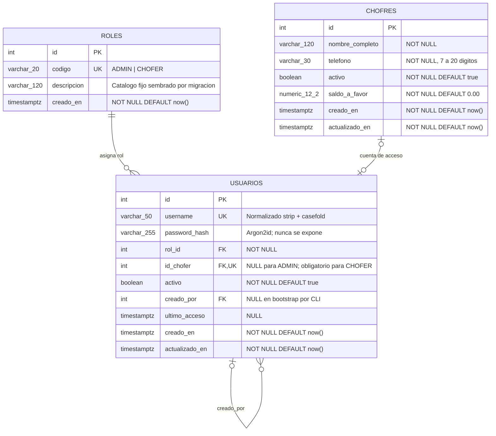

# Especificación Técnica — RBAC: Autenticación, Multi-Admin y Creación de Usuarios

**Ticket**: 1 — Autenticación, Multi-Admin y Creación de Usuarios  
**Spec base**: [`specs/009-autenticacion-roles/spec.md`](../specs/009-autenticacion-roles/spec.md)  
**Rama de trabajo**: `009-autenticacion-roles`  
**Fecha**: 2026-10-30  
**Estado**: Especificado — pendiente de aprobación del Tech Lead antes de implementar.  
**Alcance de esta entrega**: documentación técnica y modelo de datos. No incluye código de aplicación.

---

## 1. Propósito

Definir el modelo de control de acceso basado en roles (**RBAC**) para Fletes y Mudanzas Express,
con dos roles: **ADMIN** y **CHOFER**. Esta especificación amplía la historia `009` con dos
capacidades nuevas:

1. **Multi-Admin**: el sistema admite múltiples cuentas administrativas activas.
2. **Creación de usuarios**: un **ADMIN** autenticado puede crear cuentas de usuario, incluida la
   cuenta de un **CHOFER** vinculada a un chofer existente.

La autenticación sigue siendo responsabilidad del backend FastAPI. Next.js solo conserva la sesión
en una cookie `httpOnly` y reenvía el token desde el servidor. Ningún rol privilegiado se acepta
desde código cliente ni desde headers como `X-Rol`.

---

## 2. Relación con la historia 009

Esta especificación **enmienda** decisiones de `009-autenticacion-roles`. La enmienda queda
registrada en `spec.md` y `plan.md` de la historia base.

| Tema | 009 original | Ticket 1 |
|---|---|---|
| Autenticación de choferes | Fuera de alcance | **Dentro de alcance**: login y cuenta de usuario para CHOFER. |
| Alta de cuentas | Solo CLI para `admin` | Primer ADMIN por CLI; el resto por API/UI de un ADMIN autenticado. |
| Gestión de usuarios | Sin UI ni API de administración | ABM de usuarios con rol ADMIN, restringido a ADMIN. |
| Multi-admin | No explicitado | **Soportado explícitamente**: N cuentas ADMIN activas. |
| Roles | Contrato `admin`/`chofer` | Tabla `roles` con códigos canónicos `ADMIN`/`CHOFER`. |
| Migración | `0005_crear_usuarios.py` | `0006_crear_usuarios_rbac.py` (la `0005` ya está ocupada por cancelación de servicios). |
| Rutas operativas de chofer | No existían | Siguen sin habilitarse en este ticket; se difieren a la historia de operación del chofer. |

> **Compatibilidad**: `require_rol("admin")` y `require_rol("chofer")` se conservan sin cambios en
> los routers. La resolución del rol en `get_rol_actual` devuelve los códigos en minúsculas
> (`admin`, `chofer`) para no romper las declaraciones existentes, aunque el código canónico
> persistido sea `ADMIN`/`CHOFER`.

---

## 3. Actores y roles

| Rol | Descripción | Alcance en este ticket |
|---|---|---|
| **ADMIN** | Cuenta administrativa con acceso total a las funciones de gestión. | Login, `/auth/me`, ABM de usuarios, todas las rutas administrativas existentes. |
| **CHOFER** | Cuenta operativa vinculada 1:1 a un chofer activo. | Login y `/auth/me`. Sin rutas operativas de chofer en este ticket. |
| **Anónimo** | Usuario sin sesión válida. | Solo `POST /api/auth/login`. |

### 3.1 Matriz de permisos

| Operación | Anónimo | CHOFER | ADMIN |
|---|:---:|:---:|:---:|
| `POST /api/auth/login` | Sí | Sí | Sí |
| `GET /api/auth/me` | No | Sí | Sí |
| `GET /api/usuarios` | No | No | Sí |
| `POST /api/usuarios` | No | No | Sí |
| `GET /api/usuarios/{id}` | No | No | Sí |
| `PUT /api/usuarios/{id}` | No | No | Sí |
| `DELETE /api/usuarios/{id}` | No | No | Sí |
| Rutas actuales de clientes, choferes, vehículos, tipos y servicios | No | No | Sí (sin cambios) |

> Las rutas operativas para CHOFER (ver sus servicios asignados, iniciar/finalizar un viaje) se
> especifican en un ticket posterior. En este ticket, un CHOFER autenticado solo puede consultar su
> propia identidad.

---

## 4. Reglas de negocio

| ID | Regla |
|---|---|
| **BR-001** | El sistema reconoce exactamente dos roles: `ADMIN` y `CHOFER`. No se crean roles dinámicos en el MVP. |
| **BR-002** | Pueden coexistir múltiples cuentas con rol `ADMIN` activas. El sistema no asume un administrador único ni un `owner`. |
| **BR-003** | Solo un `ADMIN` autenticado puede crear cuentas de usuario. Un `CHOFER` no puede crear cuentas de ningún rol. La regla cubre el alta del chofer operativo (ruta ya restringida a `ADMIN`) y la creación de su cuenta de acceso. |
| **BR-004** | Toda cuenta `CHOFER` debe estar vinculada a exactamente un chofer existente y activo. Un chofer puede tener cero o una cuenta; no puede tener dos. |
| **BR-005** | Toda cuenta `ADMIN` debe tener `id_chofer = NULL`. La combinación rol/chofer se valida en dominio y aplicación. |
| **BR-006** | No existe registro público. El primer `ADMIN` se aprovisiona por CLI interactiva; las cuentas siguientes las crea un `ADMIN` autenticado. |
| **BR-007** | El `username` es único, se normaliza con `strip().casefold()` y se persiste normalizado. Un duplicado responde `409 Conflict`. |
| **BR-008** | La contraseña se persiste exclusivamente como hash Argon2id. Nunca se devuelve, registra ni incluye en mensajes de error. |
| **BR-009** | Los errores de login son genéricos: usuario inexistente, inactivo o contraseña incorrecta responden el mismo `401`. |
| **BR-010** | Desactivar una cuenta o cambiar su rol impacta en el siguiente request autenticado, aunque el JWT siga vigente. |
| **BR-011** | No se puede desactivar ni degradar la última cuenta `ADMIN` activa. La operación responde `409 Conflict` para evitar el bloqueo total del sistema. |
| **BR-012** | La baja de una cuenta es lógica (`activo = false`). No se eliminan filas de `usuarios`. |
| **BR-013** | La baja de una cuenta `CHOFER` no da de baja al chofer. Son ciclos de vida independientes. |
| **BR-014** | Una cuenta `CHOFER` solo puede autenticarse mientras su chofer asociado siga activo. Si el chofer se da de baja, el login y los requests autenticados se rechazan. |
| **BR-015** | Toda cuenta registra quién la creó (`creado_por`) y cuándo (`creado_en`). El bootstrap por CLI deja `creado_por = NULL`. |
| **BR-016** | El rol se resuelve desde la base en cada request. Los claims del JWT no otorgan permisos por sí solos. |

### 4.1 Decisiones de diseño propuestas

Estas decisiones se adoptan para esta especificación, pero requieren confirmación del Tech Lead:

| Decisión | Propuesta |
|---|---|
| Creación de otros ADMIN | Un `ADMIN` autenticado puede crear cuentas `ADMIN` adicionales. |
| Política de contraseña | Mínimo 12 caracteres, máximo 128, distinta del `username`. |
| Reasignación de cuenta CHOFER | No se permite cambiar `id_chofer`; se desactiva la cuenta y se crea otra. |
| Reactivación | Fuera de alcance en este ticket; se resuelve por CLI administrativa. |
| Rate limiting de login | Recomendado, pero su umbral se define en la implementación. |

---

## 5. Modelo de datos objetivo

### 5.1 Tabla `roles`

Catálogo fijo, sembrado por migración. No se administra desde la UI.

| Columna | Tipo | Restricciones |
|---|---|---|
| `id` | `integer` | PK, `IDENTITY` |
| `codigo` | `varchar(20)` | `NOT NULL`, `UNIQUE`, valores `ADMIN` o `CHOFER` |
| `descripcion` | `varchar(120)` | `NOT NULL` |
| `creado_en` | `timestamptz` | `NOT NULL DEFAULT now()` |

### 5.2 Tabla `usuarios`

| Columna | Tipo | Restricciones |
|---|---|---|
| `id` | `integer` | PK, `IDENTITY` |
| `username` | `varchar(50)` | `NOT NULL`, `UNIQUE`, normalizado |
| `password_hash` | `varchar(255)` | `NOT NULL`, Argon2id |
| `rol_id` | `integer` | `NOT NULL`, FK → `roles.id` |
| `id_chofer` | `integer` | `NULL`, FK → `choferes.id`, `UNIQUE` |
| `activo` | `boolean` | `NOT NULL DEFAULT true` |
| `creado_por` | `integer` | `NULL`, FK → `usuarios.id` |
| `ultimo_acceso` | `timestamptz` | `NULL` |
| `creado_en` | `timestamptz` | `NOT NULL DEFAULT now()` |
| `actualizado_en` | `timestamptz` | `NOT NULL DEFAULT now()` |

**Constraints e índices**

- `UNIQUE (username)` para unicidad del identificador normalizado.
- `UNIQUE (id_chofer)` para impedir dos cuentas sobre el mismo chofer (PostgreSQL permite múltiples
  `NULL`, por lo que los ADMIN no colisionan).
- FK `rol_id`, `id_chofer` y `creado_por`.
- Índices de apoyo: `(rol_id)`, `(activo)`, `(id_chofer)`.
- La coherencia `ADMIN ⇒ id_chofer IS NULL` y `CHOFER ⇒ id_chofer IS NOT NULL` se valida en la capa
  de dominio/aplicación, porque un `CHECK` simple no puede leer el código del rol en otra tabla. Se
  cubre con tests de integración.

### 5.3 Tabla `choferes`

No se modifica. La relación se materializa desde `usuarios.id_chofer`, preservando los datos
operativos del chofer y evitando una FK circular entre ambas tablas.

### 5.4 Migración

La migración nueva es `0006_crear_usuarios_rbac.py`, con `down_revision = "0005"` (cancelación de
servicios). Crea `roles`, `usuarios`, constraints, índices y siembra los dos roles. La migración
`0005` **no** se reutiliza.

---

## 6. Diagrama UML Entidad-Relación



**Lectura de cardinalidades**

- Un rol puede estar asignado a muchos usuarios; cada usuario tiene exactamente un rol.
- Un chofer puede tener cero o una cuenta; cada cuenta `CHOFER` corresponde a exactamente un chofer.
- Un usuario puede haber creado muchas cuentas; cada cuenta tiene cero o un creador.

---

## 7. Contrato API objetivo

### 7.1 Autenticación

| Método y ruta | Acceso | Request | Response |
|---|---|---|---|
| `POST /api/auth/login` | Público | `{ "username": str, "password": str }` | `200 { access_token, token_type: "bearer", expires_in }` |
| `GET /api/auth/me` | Autenticado | Bearer token | `200 { id, username, rol, id_chofer }` |

- Credenciales inválidas, usuario inactivo o chofer inactivo: `401` genérico con
  `WWW-Authenticate: Bearer`.
- Token ausente, inválido o expirado: `401`.
- `rol` se devuelve como `"ADMIN"` o `"CHOFER"`.
- Nunca se devuelve `password_hash`.

### 7.2 Gestión de usuarios

| Método y ruta | Acceso | Descripción |
|---|---|---|
| `GET /api/usuarios` | ADMIN | Listado paginado con filtros `q`, `rol`, `activo`. |
| `POST /api/usuarios` | ADMIN | Alta de cuenta `ADMIN` o `CHOFER`. |
| `GET /api/usuarios/{id}` | ADMIN | Detalle sin datos sensibles. |
| `PUT /api/usuarios/{id}` | ADMIN | Actualización completa de `username`, `rol` e `id_chofer`. |
| `DELETE /api/usuarios/{id}` | ADMIN | Baja lógica (`activo = false`). |

**Alta de usuario**

```json
{
  "username": "juan.perez",
  "password": "una-clave-segura",
  "rol": "CHOFER",
  "id_chofer": 12
}
```

Reglas del alta:

- `rol = "ADMIN"`: `id_chofer` debe omitirse o ser `null`.
- `rol = "CHOFER"`: `id_chofer` es obligatorio, el chofer debe estar activo y no debe tener otra
  cuenta.
- `username` duplicado: `409 Conflict`.
- Chofer inexistente o inactivo: `422 Unprocessable Entity`.
- Chofer ya vinculado: `409 Conflict`.
- Solicitante sin rol ADMIN: `403 Forbidden`.
- Sin token válido: `401 Unauthorized`.

**Representación de salida**

```json
{
  "id": 7,
  "username": "juan.perez",
  "rol": "CHOFER",
  "id_chofer": 12,
  "activo": true,
  "creado_por": 1,
  "creado_en": "2026-10-30T12:00:00Z",
  "actualizado_en": "2026-10-30T12:00:00Z"
}
```

### 7.3 Códigos de error

| Código | Uso |
|---|---|
| `401` | Sin token, token inválido/expirado, cuenta o chofer inactivo, credenciales inválidas. |
| `403` | Token válido sin el rol requerido. |
| `404` | Usuario o chofer inexistente en una operación puntual. |
| `409` | `username` duplicado, chofer ya vinculado, baja/degradación de la última cuenta ADMIN. |
| `422` | Payload inválido, rol/chofer inconsistente, chofer inactivo, contraseña fuera de política. |

---

## 8. Flujos funcionales

### 8.1 Login

1. El usuario envía `username` y `password` a `POST /api/auth/login`.
2. El backend normaliza el `username`, busca la cuenta activa y verifica el hash Argon2id.
3. Si el rol es `CHOFER`, verifica que el chofer asociado siga activo.
4. Emite un JWT de 30 minutos y registra `ultimo_acceso`.
5. Next.js guarda el token en cookie `httpOnly` y lo reenvía desde el servidor en cada request
   autenticado.

### 8.2 Alta de una cuenta CHOFER

1. Un `ADMIN` autenticado elige un chofer activo existente. Si el chofer no existe, primero lo crea
   con `POST /api/choferes` (ruta ya restringida a `ADMIN`); el alta de usuario no crea choferes de
   forma implícita.
2. Envía `username`, `password`, `rol = "CHOFER"` e `id_chofer` a `POST /api/usuarios`.
3. El backend valida rol, unicidad, estado del chofer y ausencia de otra cuenta vinculada.
4. Persiste la cuenta con `activo = true`, `creado_por = <id del ADMIN>` y hash Argon2id.
5. Devuelve `201 Created` sin datos sensibles.

---

## 9. Criterios de aceptación

### CA-01 — Multi-admin

**Dado** dos cuentas `ADMIN` activas,  
**cuando** ambas inician sesión,  
**entonces** las dos reciben un JWT válido y pueden operar las rutas administrativas.

### CA-02 — ADMIN crea una cuenta CHOFER

**Dado** un `ADMIN` autenticado y un chofer activo sin cuenta,  
**cuando** crea un usuario con rol `CHOFER` vinculado a ese chofer,  
**entonces** recibe `201 Created`, la cuenta queda activa y no se expone el hash.

### CA-03 — CHOFER no puede crear usuarios

**Dado** un `CHOFER` autenticado,  
**cuando** intenta `POST /api/usuarios`,  
**entonces** recibe `403 Forbidden`.

### CA-04 — Sin registro público

**Dado** un cliente anónimo,  
**cuando** intenta `POST /api/usuarios`,  
**entonces** recibe `401 Unauthorized` y no existe ruta pública de registro.

### CA-05 — Username duplicado

**Dado** un `username` ya existente,  
**cuando** un `ADMIN` intenta crear otra cuenta con el mismo valor normalizado,  
**entonces** recibe `409 Conflict`.

### CA-06 — Chofer obligatorio y activo

**Dado** un `ADMIN` autenticado,  
**cuando** crea un usuario `CHOFER` sin `id_chofer`, con un chofer inactivo o con un chofer que ya
tiene cuenta,  
**entonces** recibe `422` o `409` según el caso y no se crea la cuenta.

### CA-07 — Coherencia rol/chofer

**Dado** un `ADMIN` autenticado,  
**cuando** envía un usuario `ADMIN` con `id_chofer` o un usuario `CHOFER` sin `id_chofer`,  
**entonces** recibe `422 Unprocessable Entity`.

### CA-08 — Baja inmediata

**Dado** un usuario activo y un JWT aún vigente,  
**cuando** un `ADMIN` lo desactiva,  
**entonces** el siguiente request del usuario desactivado recibe `401`.

### CA-09 — Protección del último ADMIN

**Dado** un único `ADMIN` activo,  
**cuando** se intenta desactivarlo o cambiarle el rol,  
**entonces** recibe `409 Conflict` y la cuenta permanece activa.

### CA-10 — Confidencialidad de credenciales

**Dado** cualquier alta o consulta de usuario,  
**cuando** se inspeccionan respuesta, logs y errores,  
**entonces** no aparece la contraseña en claro ni el hash.

### CA-11 — Error de login genérico

**Dado** un usuario inexistente, inactivo o con contraseña incorrecta,  
**cuando** intenta iniciar sesión,  
**entonces** recibe el mismo `401` sin revelar cuál fue la causa.

### CA-12 — Chofer inactivo

**Dado** una cuenta `CHOFER` cuyo chofer fue dado de baja,  
**cuando** intenta iniciar sesión o reutiliza un JWT vigente,  
**entonces** recibe `401`.

---

## 10. Seguridad y requisitos no funcionales

- **Hash**: Argon2id con parámetros documentados en configuración; comparación resistente a timing.
- **JWT**: algoritmo fijo, `sub` y `exp` obligatorios, TTL de 30 minutos, secreto obligatorio sin
  valor por defecto productivo.
- **Cookies**: `httpOnly`, `sameSite=lax`, `secure` en producción, `path=/`, expiración alineada al
  token.
- **Autorización**: el backend es la frontera de seguridad; Next.js valida sesión en layouts,
  Server Actions y acceso a datos, pero no reemplaza la validación de la API.
- **Roles**: se leen de la base en cada request; un JWT con rol obsoleto no conserva permisos.
- **Enumeración**: login y recuperación no revelan existencia ni estado de cuentas.
- **Auditoría**: `creado_por`, `creado_en`, `ultimo_acceso` y estado `activo`.
- **Logs**: prohibido registrar contraseñas, hashes o tokens completos.
- **Migraciones**: `0006` aditiva; no destructiva sobre `choferes`.

---

## 11. Impacto por capas (sin código en esta entrega)

| Capa | Componentes previstos |
|---|---|
| Dominio | Entidad `Usuario`, value object `Rol`, invariantes BR-004/BR-005/BR-011/BR-014. |
| Aplicación | `GestorAutenticacion`, `GestorUsuarios`, puertos de repositorio, hasher y emisor/validador de tokens. |
| Infraestructura | `RolORM`, `UsuarioORM`, `UsuarioRepo`, `PasswordHasher`, `JwtService`, migración `0006`. |
| Presentación API | Schemas Pydantic, router `/api/auth`, router `/api/usuarios`, `require_rol` conservado. |
| Frontend | `/login`, guardas server-side, layout admin, pantalla `/usuarios` restringida a ADMIN, tipos OpenAPI regenerados. |
| CLI | Comando de bootstrap del primer ADMIN y provisión administrativa fuera de la UI. |
| Pruebas | Unitarias de reglas, seguridad y casos de uso; integración de API; Vitest/RTL para login y alta. |

---

## 12. Fuera de alcance

- Registro público de usuarios.
- Roles dinámicos o permisos granulares por endpoint.
- Refresh tokens, revocación global de sesiones y MFA.
- Recuperación o cambio de contraseña desde la UI.
- Rutas operativas del chofer (servicios asignados, inicio/fin de viaje).
- Reactivación de cuentas desde la UI.
- Edición de la tabla `choferes` o migración destructiva.

---

## 13. Decisiones abiertas

1. Confirmar la política de contraseña (mínimo 12 caracteres).
2. Confirmar si un `ADMIN` puede crear otros `ADMIN` o si eso queda solo en la CLI.
3. Definir el umbral de rate limiting para `POST /api/auth/login`.
4. Definir si una cuenta `CHOFER` desactivada puede reactivarse desde la UI en una historia futura.
5. Confirmar si el alta combinada “chofer + cuenta” se resuelve en la UI con dos llamadas
   compensadas o con un endpoint de onboarding dedicado.

---

## 14. Trazabilidad

- Enmienda registrada en `specs/009-autenticacion-roles/spec.md`.
- Ajuste de migración y alcance registrado en `specs/009-autenticacion-roles/plan.md`.
- Historias `US-009.4` y `US-009.5` agregadas en `docs/historias-de-usuario.md`.
- El modelo ERD de este documento complementa el ERD de migraciones `0001` a `0005` de
  `docs/diagramas-arquitectura-y-dominio.md`.
