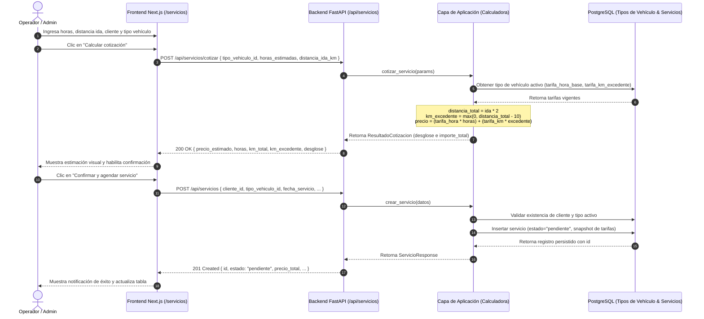
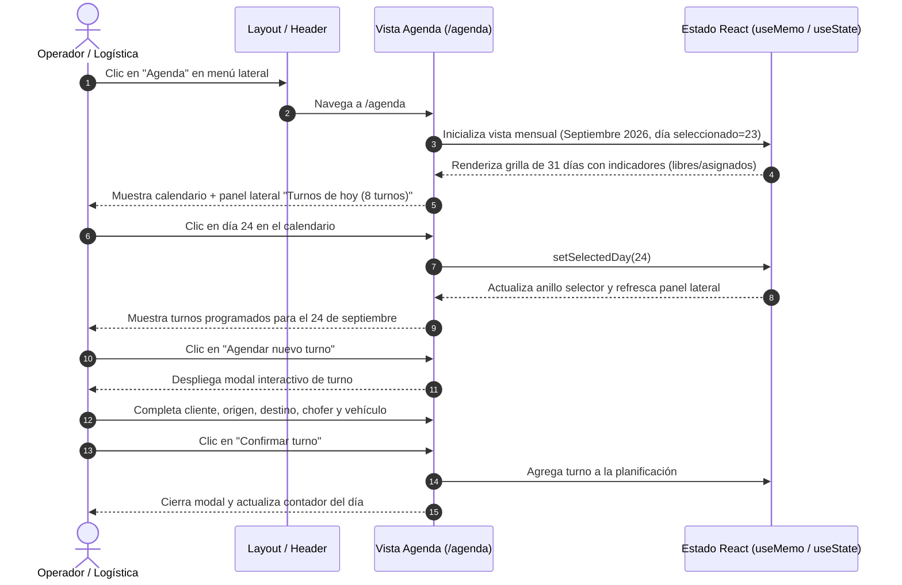
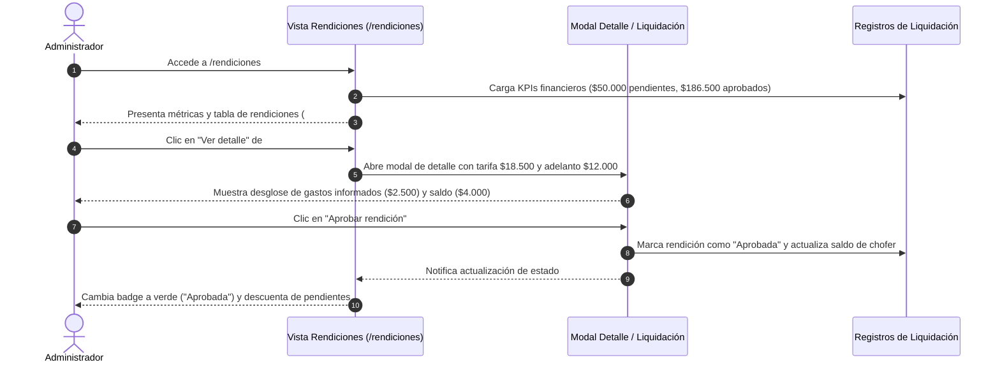
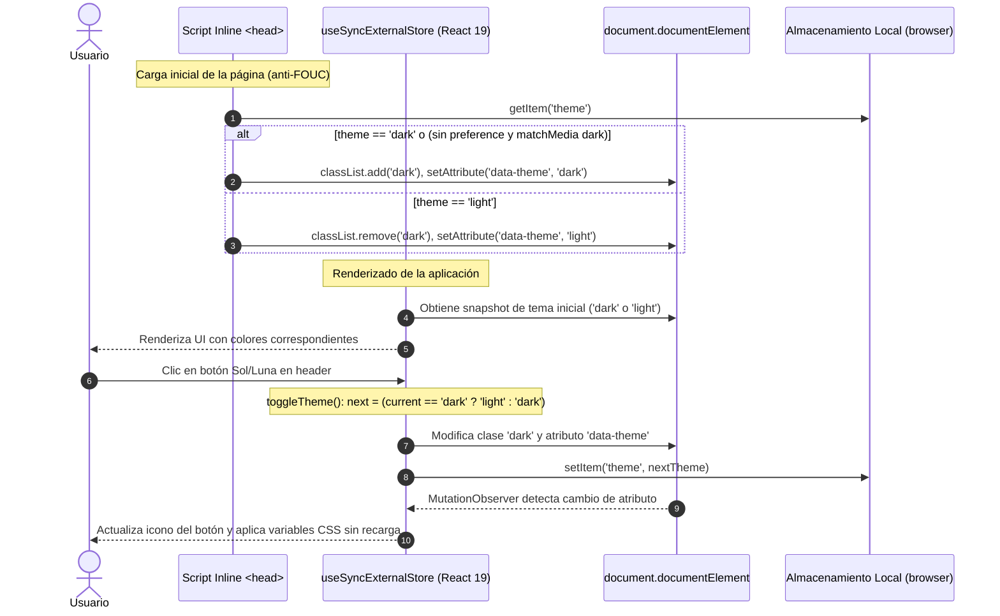

# SSD — System Sequence Diagrams (Diagramas de Secuencia del Sistema)
## Historia H8: Gestión de Servicios, Cotizaciones, Agenda y Rendiciones

**Proyecto**: Fletes y Mudanzas Express (MVP 1)  
**Cátedra**: Trabajo Integrador de Prácticas Pre-Profesionales 1 (2026) — Licenciatura en Sistemas, UNLa  
**Rama**: `008-frontend-gestion-servicios`  
**Fecha de actualización**: Octubre 2026  

---

## 1. Arquitectura y Contexto de Integración

El sistema está estructurado como un **monolito modular en capas** (Backend FastAPI + PostgreSQL) interactuando con un frontend web responsive en **Next.js 16 (App Router)**, **React 19** y **TypeScript**.

```
[ Usuario / Operador ]
         ↕ HTTP (Fetch / RSC / Server Actions)
[ Presentación (Next.js 16) ] ── (Tema: Modo Claro / Oscuro con useSyncExternalStore)
         ↕ REST API (JSON)
[ API FastAPI (app/api/) ]
         ↕ Inyección de dependencias
[ Capa de Aplicación (app/application/) ] ── (Calculadora, Validador, Gestor de Pagos/Rendición)
         ↕ Entidades y reglas invariantes
[ Capa de Dominio (app/domain/) ]
         ↕ Repositorios
[ Infraestructura (app/infrastructure/) ] ── (PostgreSQL / SQLAlchemy)
```

---

## 2. Diagramas de Secuencia del Sistema (SSD)

### SSD-01: Cotización Oficial y Alta de Servicio

Representa el flujo de cálculo no persistido y la creación definitiva del servicio. El frontend nunca calcula las tarifas oficiales de la empresa: envía parámetros y recibe el cálculo exacto del backend antes de permitir el alta.



---

### SSD-02: Agenda Operativa y Planificación Mensual

Representa la visualización del calendario mensual interactivo, la consulta de turnos del día y la planificación de nuevos viajes.



---

### SSD-03: Arqueo Financiero y Rendición de Choferes

Representa el proceso de liquidación de viajes, verificación de gastos informados (peajes, combustible) y cierre de saldos.



---

### SSD-04: Conmutación y Persistencia de Modo Oscuro / Modo Claro

Representa el ciclo de vida del tema visual, evitando el parpadeo de contenido desalineado (FOUC) y garantizando la sincronización con React 19 mediante `useSyncExternalStore`.



---

## 3. Matriz de Trazabilidad: Vistas vs. Capacidades

| Vista | Ruta | Componentes Clave | Modo Oscuro | Integración Backend |
|---|---|---|---|---|
| **Dashboard** | `/` | `DashboardPage`, `StatusBadge`, KPIs | Soportado (`dark:bg-[#111c2e]`) | Mockup operativo de alta fidelidad |
| **Agenda** | `/agenda` | `PaginaAgenda`, Calendario 31 días, Turnos de hoy | Soportado | Interactivo local |
| **Cotizaciones** | `/cotizaciones` | `PaginaCotizaciones`, Calculadora, Desglose total | Soportado | Interactivo comercial |
| **Servicios** | `/servicios` | `FormularioServicio`, `ListadoServicios`, `Paginacion` | Soportado | **100% Real FastAPI** (`/api/servicios`) |
| **Choferes** | `/choferes` | `ListadoChoferes`, `BuscadorChoferes`, Disponibilidad | Soportado | **100% Real FastAPI** (`/api/choferes`) |
| **Vehículos** | `/vehiculos` | `ListadoVehiculos`, `BuscadorVehiculos`, Tarjetas Flota | Soportado | **100% Real FastAPI** (`/api/vehiculos`) |
| **Clientes** | `/clientes` | `ListadoClientes`, `BuscadorClientes`, Header badge | Soportado | **100% Real FastAPI** (`/api/clientes`) |
| **Rendiciones** | `/rendiciones` | `PaginaRendiciones`, Modales Arqueo y Liquidación | Soportado | Interactivo financiero |
| **Shell** | Todas | `AdminShell`, Sidebar responsive, Theme Toggle | Soportado | Shell global |
