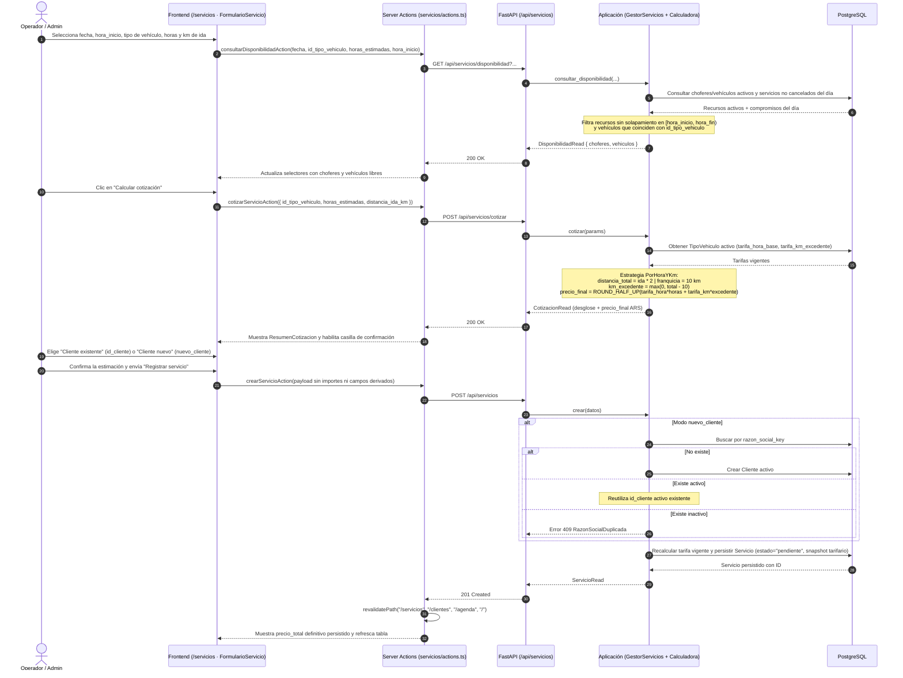
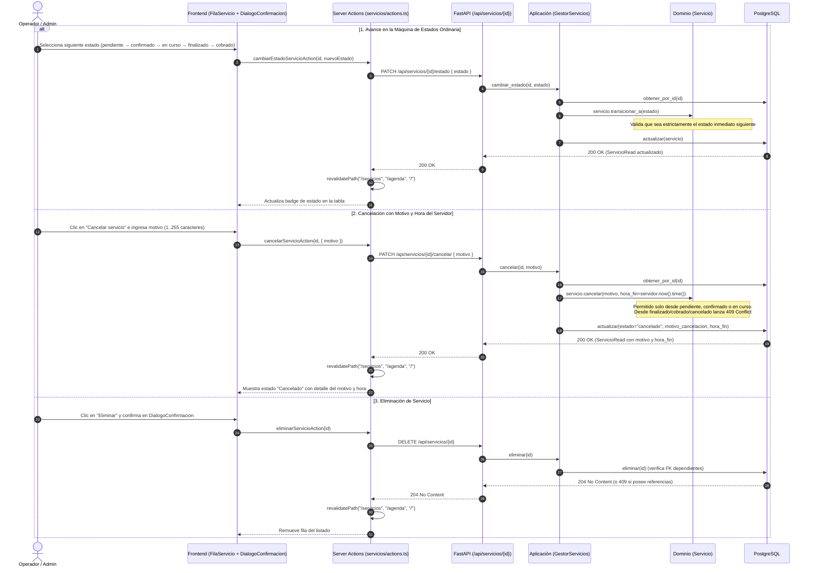
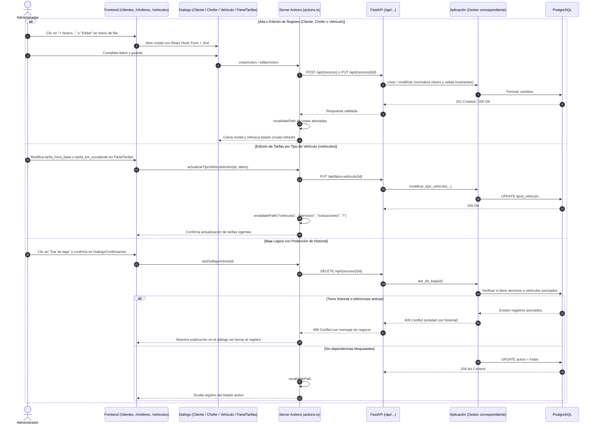
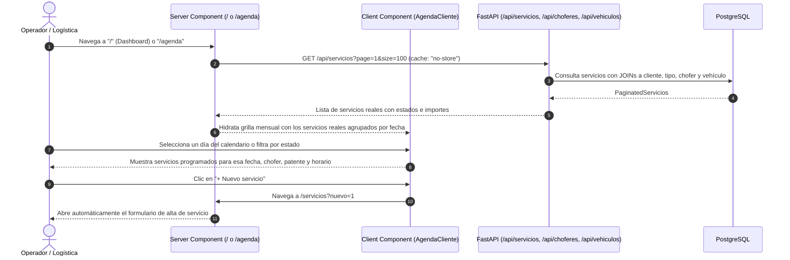
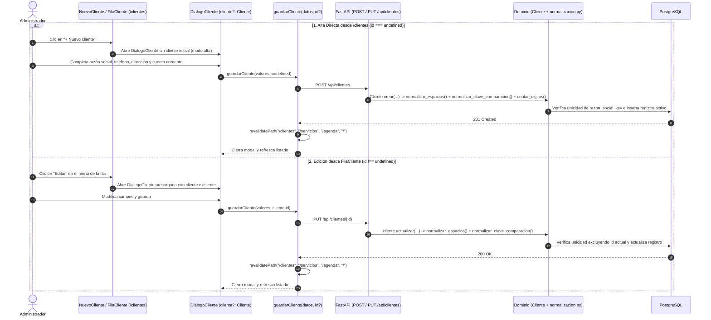

# SSD — System Sequence Diagrams (Diagramas de Secuencia del Sistema)
## Historia H8 e Integración General: Servicios, Cotizaciones, Catálogos, Agenda y Operaciones

**Proyecto**: Fletes y Mudanzas Express (MVP 1)  
**Cátedra**: Trabajo Integrador de Prácticas Pre-Profesionales 1 (2026) — Licenciatura en Sistemas, UNLa  
**Rama consolidada**: `main` (integración completa de `008-frontend-gestion-servicios` y `feature/frontend-integracion-ui`)  
**Fecha de actualización**: Octubre 2026  

---

## 1. Arquitectura y Contexto de Integración

El sistema está estructurado como un **monolito modular en capas** (Backend FastAPI + PostgreSQL 16) interactuando con un frontend web responsive en **Next.js 16 (App Router, Turbopack)**, **React 19** y **TypeScript**, comunicados mediante Server Components, Server Actions y validación de esquemas con **React Hook Form + Zod**.

```
[ Usuario / Operador Administrativo ]
         ↕ Interacción UI (RSC + Server Actions + RHF/Zod)
[ Presentación Frontend (Next.js 16) ] ── (Tema Claro/Oscuro anti-FOUC con useSyncExternalStore)
         ↕ REST API JSON (http.ts con fallback backend:8000 / localhost:8000, cache: "no-store")
[ Capa de Presentación Backend (app/api/) ] ── (Validación Pydantic extra="forbid" + require_rol)
         ↕ Inyección de dependencias (Protocols)
[ Capa de Aplicación (app/application/) ] ── (Gestores de Servicios, Clientes, Choferes, Vehículos y Calculadora Strategy)
         ↕ Entidades e invariantes puras
[ Capa de Dominio (app/domain/) ] ── (Máquina de estados de Servicio, reglas de baja y normalización)
         ↕ Repositorios SQLAlchemy
[ Capa de Infraestructura (app/infrastructure/) ] ── (PostgreSQL 16 + Migraciones Alembic 0001..0005)
```

---

## 2. Diagramas de Secuencia del Sistema (SSD)

### SSD-01: Cotización Oficial, Disponibilidad Informativa y Alta de Servicio (Cliente Existente o Nuevo)

Representa el flujo completo de extremo a extremo para cotizar un viaje sin persistencia, consultar choferes y vehículos disponibles en la franja horaria elegida y registrar el servicio con snapshot tarifario inmutable (reutilizando o creando un cliente nuevo en la misma transacción).



---

### SSD-02: Ciclo de Vida del Servicio (Transición de Estado, Cancelación y Eliminación)

Representa las tres operaciones de gestión sobre un servicio ya registrado desde el menú de acciones de cada fila (`FilaServicio`) con sus respectivos diálogos de confirmación (`DialogoConfirmacion`).



---

### SSD-03: Gestión Integral de Catálogos (Clientes, Choferes, Vehículos) y Tarifas por Tipo

Representa el alta, edición completa (`PUT`), baja lógica protegida (`DELETE` con bloqueo `409` ante servicios históricos) y la actualización de tarifas en `/vehiculos` que alimenta al cotizador.



---

### SSD-04: Agenda Operativa y Dashboard Conectados al Backend Real

Representa la carga server-side del Dashboard (`/`) y de la Agenda (`/agenda`) consumiendo los servicios, choferes y vehículos reales desde FastAPI.



---

### SSD-05: Conmutación y Persistencia de Modo Oscuro / Modo Claro

Representa el ciclo de vida del tema visual, evitando el parpadeo de contenido desalineado (FOUC) y garantizando la sincronización con React 19 mediante `useSyncExternalStore`.


---

### SSD-06: Refactorización — Simetría de Alta/Edición en `/clientes` y Normalización Compartida en Dominio

Representa la consolidación del flujo de alta y edición en `/clientes` (`NuevoCliente` + `DialogoCliente` + `guardarCliente(datos, id?)`) junto con la centralización de las primitivas de normalización de texto y conteo de dígitos en `app/domain/normalizacion.py`.



---

## 3. Matriz de Trazabilidad Actualizada: Vistas vs. Capacidades y Endpoints

| Vista | Ruta | Componentes Clave | Modo Oscuro | Integración con Backend FastAPI |
|---|---|---|---|---|
| **Dashboard** | `/` | `DashboardPage`, KPIs operativos, tabla de viajes y acceso `/servicios?nuevo=1` | Soportado | **100% Real FastAPI** (`GET /api/servicios`, `/api/choferes`, `/api/vehiculos`) |
| **Agenda** | `/agenda` | `PaginaAgenda`, `AgendaCliente`, calendario mensual interactivo y detalle diario | Soportado | **100% Real FastAPI** (`GET /api/servicios`) |
| **Cotizaciones** | `/cotizaciones` | `PaginaCotizaciones`, `Cotizador`, desglose oficial ARS | Soportado | **100% Real FastAPI** (`GET /api/tipos-vehiculo`, `POST /api/servicios/cotizar`) |
| **Servicios** | `/servicios` | `FormularioServicio`, `ListadoServicios`, `FilaServicio`, `DialogoConfirmacion` | Soportado | **100% Real FastAPI** (`GET/POST /api/servicios`, `POST /cotizar`, `GET /disponibilidad`, `PATCH /{id}/estado`, `PATCH /{id}/cancelar`, `DELETE /{id}`) |
| **Choferes** | `/choferes` | `ListadoChoferes`, `FilaChofer`, `DialogoChofer`, `BuscadorChoferes` | Soportado | **100% Real FastAPI** (`GET/POST /api/choferes`, `PUT/DELETE /api/choferes/{id}`) |
| **Vehículos y Tarifas** | `/vehiculos` | `PanelTarifas`, `ListadoVehiculos`, `FilaVehiculo`, `DialogoVehiculo` | Soportado | **100% Real FastAPI** (`GET/POST /api/vehiculos`, `PUT/DELETE /api/vehiculos/{id}`, `GET/PUT /api/tipos-vehiculo/{id}`) |
| **Clientes** | `/clientes` | `ListadoClientes`, `FilaCliente`, `DialogoCliente`, `BuscadorClientes` | Soportado | **100% Real FastAPI** (`GET/POST /api/clientes`, `PUT/DELETE /api/clientes/{id}`) |
| **Rendiciones** | `/rendiciones` | `PaginaRendiciones`, modales de arqueo y liquidación | Soportado | Prototipo interactivo financiero (pendiente historia de backend de rendiciones) |
| **Shell Global** | Todas | `AdminShell`, sidebar responsive, selector Sol/Luna | Soportado | Layout transversal |
