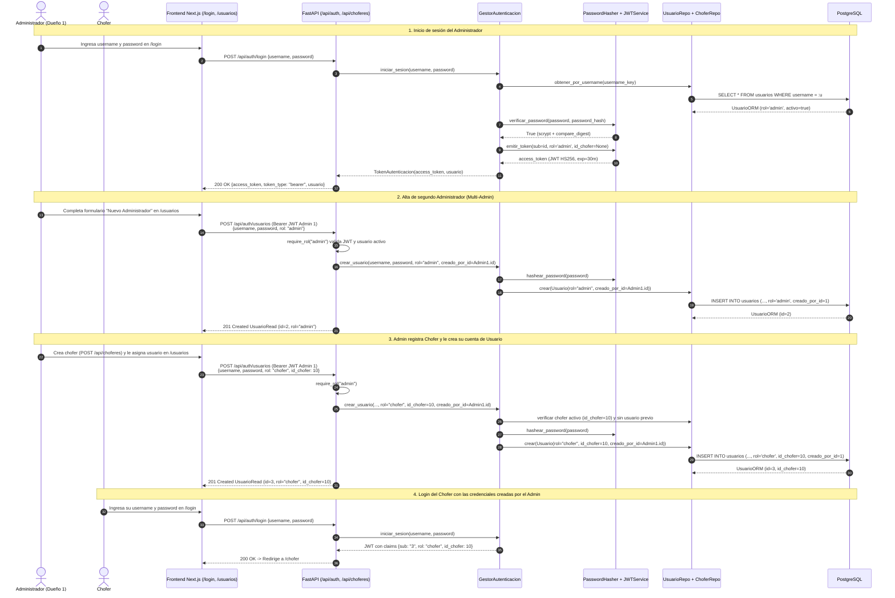
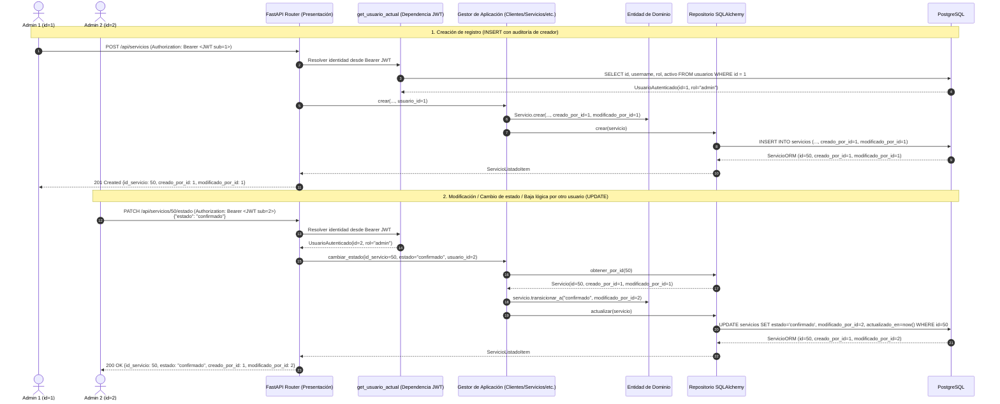
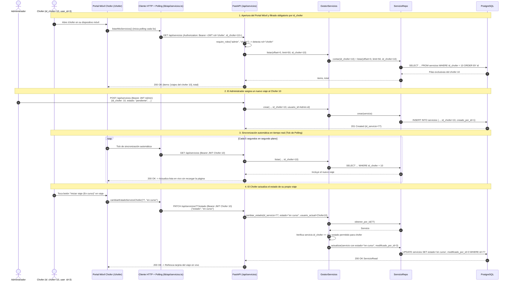

# Diagramas de Secuencia del Sistema (SSD) — 009: Autenticación, Auditoría y Portal del Chofer

**Rama**: `009-autenticacion-roles` | **Fecha**: 2026-10-29 | **Spec**: [spec.md](./spec.md) | **Plan**: [plan.md](./plan.md)

Este documento modela los **3 Diagramas de Secuencia del Sistema (SSD)** correspondientes a los tres
tickets de negocio implementados en la historia `009`.

---

## SSD-009-1: Autenticación JWT, Multi-Admin y Creación de Usuarios (`admin` / `chofer`)

**Cubre**:
- Login unificado con emisión de JWT `HS256` (`POST /api/auth/login`).
- Creación de múltiples cuentas de Administrador (Multi-Admin) por un dueño autenticado.
- Creación de usuario y contraseña para un Chofer existente (`POST /api/auth/usuarios`), validando
  que solo el rol `admin` pueda crear choferes (`POST /api/choferes`) y cuentas de acceso.

---

## SSD-009-2: Trazabilidad y Auditoría ("El Quién hizo qué")

**Cubre**:
- Extracción automática del `usuario.id` desde el token JWT en la capa de Presentación/Aplicación.
- Persistencia de `creado_por_id` y `modificado_por_id` en todas las tablas operativas (`clientes`,
  `choferes`, `tipos_vehiculo`, `vehiculos`, `servicios`, `usuarios`) al crear, editar, cambiar
  estado, cancelar o dar de baja lógica.

---

## SSD-009-3: Vista Restringida del Chofer y Sincronización en Tiempo Real

**Cubre**:
- Filtrado estricto `WHERE id_chofer = token.id_chofer` en `GET /api/servicios` cuando el token es
  de rol `chofer`.
- Sincronización automática periódica (polling cada 5 segundos en `frontend/src/lib/api/servicios.ts`)
  para que el chofer vea en su pantalla móvil los viajes que el administrador le asigna en tiempo
  real.
- Actualización de estado operativa (`confirmado → en curso → finalizado`) por el propio chofer con
  validación de pertenencia (`servicio.id_chofer == usuario.id_chofer`).

---

## Matriz de Trazabilidad (Historia 009)

| Ticket | SSD | Endpoints / Componentes | Reglas de Negocio Verificadas |
|---|---|---|---|
| **1. Autenticación, Multi-Admin y Usuarios** | `SSD-009-1` | `POST /api/auth/login`, `GET /api/auth/me`, `GET /api/auth/usuarios`, `POST /api/auth/usuarios`, `/login`, `/usuarios` | Hash `scrypt`, JWT `HS256`, múltiples cuentas `admin`, alta de cuenta `chofer` exclusiva por `admin`, protección `403` en `POST /api/choferes`. |
| **2. Trazabilidad y Auditoría** | `SSD-009-2` | `ClienteORM`, `ChoferORM`, `TipoVehiculoORM`, `VehiculoORM`, `ServicioORM`, `UsuarioORM`, Gestores de Aplicación | Columnas `creado_por_id` y `modificado_por_id` pobladas automáticamente desde el token JWT en altas, modificaciones, cambios de estado, cancelaciones y bajas lógicas. |
| **3. Vista Restringida del Chofer y Tiempo Real** | `SSD-009-3` | `GET /api/servicios`, `PATCH /api/servicios/{id}/estado`, `frontend/src/lib/api/servicios.ts`, `/chofer` | Filtro obligatorio `WHERE id_chofer = token.id_chofer`, bloqueo `403` sobre viajes ajenos, polling automático cada 5s en el portal móvil del chofer. |
